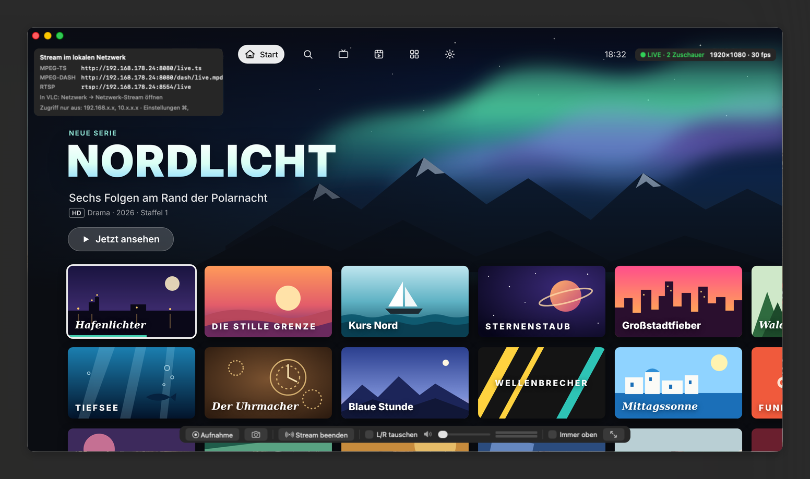

# HDMI Capture

A small macOS app for USB HDMI capture sticks based on the MacroSilicon MS2109 chip.



*The picture shows a set-top box connected via HDMI; the menu and titles are fictional.*

- Live picture at 1920×1080 with 30 or 60 fps (uses the card's MJPEG mode instead of the 5 fps default mode)
- True stereo audio: the chip reports 96 kHz mono but actually delivers 48 kHz stereo, and the app interprets it correctly
- Recording to MP4 (hardware H.264 or HEVC, AAC stereo) in `~/Movies/HDMI Capture/`. The file is written in
  10-second fragments, so it stays playable if the app crashes, the power fails or the disk fills up. The record
  button shows the running time.
- Screenshots of the current frame at full resolution, saved as PNG to `~/Pictures/HDMI Capture/` or copied to the clipboard
- Streaming to your local network (e.g. to VLC or Safari on an iPad) as MPEG-TS over HTTP, HLS, MPEG-DASH and RTSP,
  with a QR code to open the stream on the iPad
- Input menu to choose the video and audio device (several capture sticks, other capture devices)
- Swap left/right channels, volume control, level meter, full screen, "Always on top"

## Streaming

Click **Stream** in the control bar (or press ⌘K). The addresses appear in the top-left corner of the window:

| Format | Address | Notes |
|---|---|---|
| MPEG-TS over HTTP | `http://<mac-ip>:8080/live.ts` | Shortest delay (about 1–2 s in VLC) |
| HLS | `http://<mac-ip>:8080/hls/live.m3u8` | Plays natively in Safari (iPad, iPhone, Mac), AirPlay to an Apple TV |
| MPEG-DASH | `http://<mac-ip>:8080/dash/live.mpd` | Segment length selectable in Settings (0.533 / 1.067 / 2.133 s), shared with HLS |
| RTSP | `rtsp://<mac-ip>:8554/live` | RTP over TCP (interleaved); UDP is refused, VLC and ffmpeg switch automatically |

In VLC (iPad, iPhone, Mac): **Network → Open Network Stream** and enter one of the addresses. Easier: scan the
**QR code** in the stream panel with the iPad camera. It opens the MPEG-TS stream in VLC, or – switch it to
"Browser" – the player page in Safari.

`http://<mac-ip>:8080/` opens a page with a player plus all addresses with "Open in VLC" links. Nothing plays until
you start it: **Play natively (HLS)** (Safari; needs no internet access) or **Play with dash.js** (loads dash.js 5.2.1
from `cdn.dashjs.org`, so the viewing device needs internet access; the stream itself stays in the local network).
Both show the live latency and buffer level.

The stream uses H.264 or HEVC at 1080p with 30 or 60 fps and AAC stereo; codec and bit rate are selectable (see
below). The status shows `LIVE` and the number of viewers.

macOS may ask whether HDMI Capture may accept incoming network connections or access the local network; allow it.

### Segment length (DASH and HLS)

Settings (⌘,) offers three segment lengths: **0.533 s**, **1.067 s** (default) and **2.133 s**. They are
multiples of 0.533 s, because that is exactly as long as 25 AAC frames at 48 kHz (16 frames at 30 fps, 32 at
60 fps), so video and audio segments end together. Shorter segments reduce the delay in players that keep a few
segments behind the live edge (dash.js, Safari); the MPD also announces a latency target of three segments. With
0.533 s there are twice as many keyframes, so a higher bit rate helps. Keyframes come every segment, at most
every 1.067 s. A new length takes effect the next time streaming starts.

### Video: frame rate, codec and bit rate

Settings (⌘,) has a **frame rate** of 30 (default) or 60 fps; it applies immediately. 60 fps only helps if the
source outputs 60 Hz. Stream and recordings each have their own **codec** and **bit rate**:

- **H.264** (default) plays everywhere. **HEVC (H.265)** needs roughly half the bit rate for the same picture;
  VLC, QuickTime and Safari play it, Firefox doesn't. For the stream, HEVC applies to all four formats.
- **5, 8, 16 (default) or 30 Mbit/s.** Higher rates look better; 16 Mbit/s is usually fine over Wi-Fi, 30 Mbit/s is
  better suited to a cable or strong Wi-Fi.

Stream settings apply the next time streaming starts, recording settings to the next recording.

If the picture stays black: copy-protected content (HDCP), for example from streaming apps, can stay black – the
source and the capture stick decide that, the app can't change it. If the picture doesn't come back after changing
the frame rate or the input device, quit and restart the app. The Settings window shows the same hint.

### Who can watch

The stream servers only run while streaming is switched on; nothing listens when the app is closed or
streaming is off. Connections are only accepted from the networks listed under **Settings (⌘,)**, by default
`192.168.x.x` and `10.x.x.x`. The Mac itself always has access. One entry per line, for example:

```
192.168.x.x          # all of 192.168.0.0/16
192.168.178.0/24     # only the home network of a FRITZ!Box
192.168.178.30       # a single device
fd00::/8             # local IPv6 addresses
```

Changes apply immediately; viewers from networks that are no longer allowed are disconnected. A rejected
connection shows a notice in the app. The stream itself is not encrypted and has no password.

### Troubleshooting

If the stream plays on the Mac but not on other devices:

- Open `http://<mac-ip>:8080/` in Safari on the other device. If the page loads but VLC can't play, allow VLC
  under **Settings → Privacy & Security → Local Network** on the iPad/iPhone.
- Check that the device is in an allowed network and not in a guest Wi-Fi (on a FRITZ!Box the guest network
  is 192.168.179.x and can't reach the home network).
- If the macOS firewall is on, HDMI Capture needs "Allow incoming connections" under
  **System Settings → Network → Firewall → Options**. Because the app is ad-hoc signed, this may be needed
  again after each rebuild.

## Choosing the input

The **Input** menu lists all video and audio devices. **Automatic** (the default) picks the MS2109 stick and its
audio device. With several sticks or another capture device, choose the video and audio device yourself; the
choice is remembered. Devices can't be switched during a recording. If a device is unplugged, the app switches
to another one; when the chosen one comes back, it is used again.

## Download

Get the latest version from [Releases](https://github.com/removogel/HDMI-Capture/releases/latest).
It runs on macOS 14 or newer, on Apple Silicon and Intel Macs. No other software (ffmpeg, SoX …) is needed.

The app is not notarized by Apple, so macOS blocks it the first time you open it. Go to
**System Settings → Privacy & Security** and click **Open Anyway**, or run:

```bash
xattr -dr com.apple.quarantine "/Applications/HDMI Capture.app"
```

## Building

Requires the Xcode Command Line Tools.

```bash
./build.sh
open "build/HDMI Capture.app"
```

`build.sh` produces a universal app (arm64 + x86_64). On first launch, macOS asks for camera and microphone
access. Because the app is only signed locally (ad hoc), the prompt may come back after each rebuild.

For troubleshooting, start the app directly from Terminal. It then prints the frame rate, audio format and
buffer level to the terminal every 10 seconds:

```bash
"build/HDMI Capture.app/Contents/MacOS/HDMICapture"
```

## Keyboard shortcuts

| Shortcut | Action |
|---|---|
| ⌘R | Start / stop recording |
| ⌘S | Save screenshot |
| ⌘C | Copy current frame to the clipboard |
| ⌘K | Start / stop streaming |
| ⌘, | Settings (allowed networks, segment length, frame rate, codecs, bit rates) |
| ⌘L | Swap left/right channels |
| ⌘↑ / ⌘↓ | Volume up / down |
| ⌃⌘F, double-click | Full screen |
| Esc | Exit full screen |
| ⌘T | Always on top |
